<div align="center">


# 迹中局 · City as a Story

**让探索有故事，让好奇有回应。**

### 2026年北京AI青年国际黑客松现场开发作品 · 文化赛道

团队：**文化工作者要有文化**

以游戏的方式打开文化旅行：沿真实景点寻找线索，与 NPC 同行，在观察、解谜与记录中读懂一座园林。

[立即在线体验](https://jizhongju.xiaolinyx.me) · [Web 演示视频](https://jizhongju.xiaolinyx.me/showcase/index.html#web) · [移动端演示视频](https://jizhongju.xiaolinyx.me/showcase/index.html#mobile)

</div>

> 这是黑客松现场开发并持续迭代的可交互作品，首发场景为北京颐和园。目前提供响应式 Web 体验，可在电脑和手机浏览器打开；微信小程序属于后续规划。本仓库同时保留两套《颐和谜境》体验，便于比较插画叙事与实景探索的不同表达。

## 目录

- [在线体验与扫码入口](#在线体验与扫码入口)
- [演示视频](#演示视频)
- [项目海报](#项目海报)
- [项目介绍与设计初衷](#项目介绍与设计初衷)
- [面向谁以及如何体验](#面向谁以及如何体验)
- [核心功能与界面展示](#核心功能与界面展示)
- [两套故事与关卡设计](#两套故事与关卡设计)
- [AI 的使用方式](#ai-的使用方式)
- [技术栈与系统架构](#技术栈与系统架构)
- [本地运行与部署](#本地运行与部署)
- [数据保存与隐私边界](#数据保存与隐私边界)
- [当前完成度与后续计划](#当前完成度与后续计划)
- [素材来源与团队](#素材来源与团队)

## 在线体验与扫码入口

**体验网址：[https://jizhongju.xiaolinyx.me](https://jizhongju.xiaolinyx.me)**

| 入口 | 内容 |
| --- | --- |
| [地图首页](https://jizhongju.xiaolinyx.me/#map) | 从全国视野进入北京与颐和园，寻找故事入口 |
| [故事档案](https://jizhongju.xiaolinyx.me/#archive) | 对比两套《颐和谜境》，选择想体验的故事 |
| [颐和谜境（2）](https://jizhongju.xiaolinyx.me/#expedition) | 阅读背景序章，跟随阿衡开启 A/B 双线寻迹 |
| [第二卷图鉴](https://jizhongju.xiaolinyx.me/#collection-2) | 查看第二卷独立收集的信物、照片与旅程卷宗 |
| [演示视频展厅](https://jizhongju.xiaolinyx.me/showcase/index.html) | 在线播放 Web 和移动端录屏 |

<p align="center"><a href="https://jizhongju.xiaolinyx.me"></a><br/>手机扫码体验，也可以直接点击上方链接。</p>

**首次体验建议：**打开故事档案 → 选择《颐和谜境（2）》→ 阅读“日落之前”序章 → 接过手札 → 跟随阿衡寻找乐寿堂的三件器物。比赛演示无需到达景区，也不强制定位、拍照或上传；演示记录不计作真实到访。需要播放配音时，请先轻触页面或点击重播，以满足手机浏览器的音频播放要求。

## 演示视频

两段视频均由团队提供，录制于 **2026-10-31**，反映当时的开发展示版本；目前线上功能已继续迭代。视频保留完整时长，转为 H.264 / MP4 并优化首屏加载，原始录屏没有音轨。

### Web 端演示 · 约 2 分 02 秒

[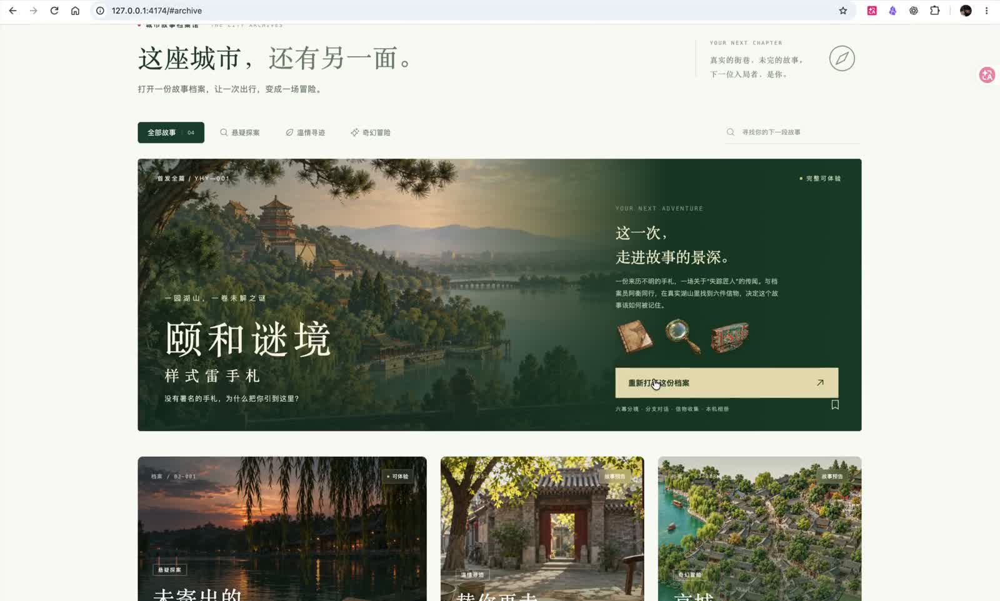](https://jizhongju.xiaolinyx.me/showcase/index.html#web)

[▶ 在线播放 Web 完整演示](https://jizhongju.xiaolinyx.me/showcase/index.html#web) · [直接打开 MP4](https://jizhongju.xiaolinyx.me/showcase/web-demo.mp4) · [仓库内视频文件](public/showcase/web-demo.mp4)

横屏展示网页端的场景与操作流程，适合在电脑上查看整体布局。在线播放页提供播放、暂停、进度拖动与全屏控件。

### 移动端演示 · 约 1 分 33 秒

<p align="center"><a href="https://jizhongju.xiaolinyx.me/showcase/index.html#mobile">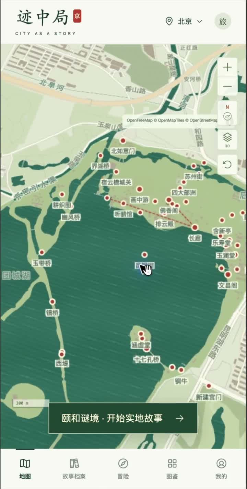</a></p>

[▶ 在线播放移动端完整演示](https://jizhongju.xiaolinyx.me/showcase/index.html#mobile) · [直接打开 MP4](https://jizhongju.xiaolinyx.me/showcase/mobile-demo.mp4) · [仓库内视频文件](public/showcase/mobile-demo.mp4)

竖屏展示手机浏览器的观看与操作方式。README 使用可点击封面进入在线播放页，无需先下载视频。

## 项目海报

<p align="center">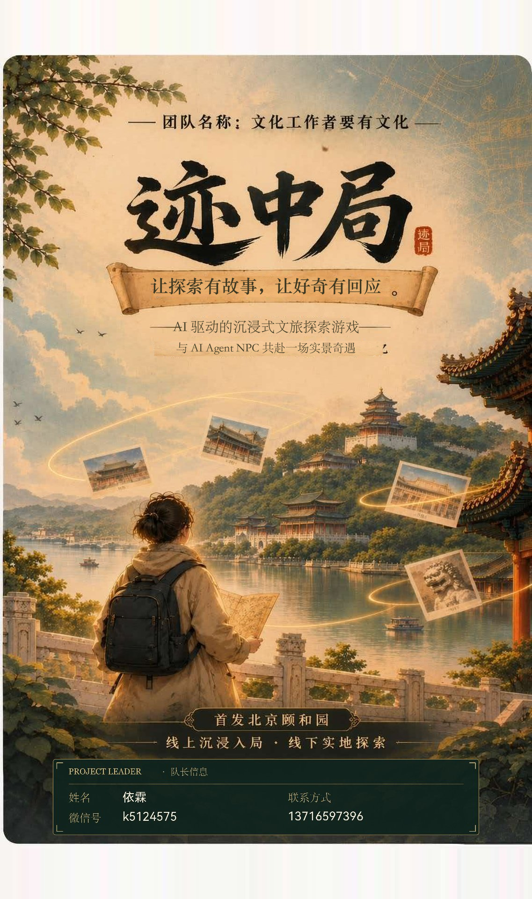</p>

海报展示作品的核心主张：以沉浸式故事连接线索、景观与个人回忆。海报中的“AI Agent NPC”是团队的产品愿景表达；当前公开演示的 NPC 以预设剧情和语音播放为主，具体能力见下文。

## 项目介绍与设计初衷

第一次来到陌生城市，游客经常面对两种游览方式：跟着人流走，或按照地图逐点打卡。它们解决了“去哪儿”，却未必回答“为什么值得停下来观察”。建筑、彩画、匾额和桥梁蕴含的文化线索，容易在走马观花中被错过。

**迹中局希望把一段旅行变成一场有目的、有反馈、有记忆的探索。**玩家从故事档案接下一项委托，在真实地点寻找与剧情有关的细节：辨认庭院里的陈设、观察长廊彩画、比较建筑图样、寻找合适的借景视角。NPC 负责引入矛盾、提出问题、给出提示与回应；玩家的观察、选择和记录推动故事继续。

我们的体验设计围绕三个连接展开：

1. **故事连接地点。**线索必须与这一站的建筑或文化细节有关，景点自身成为谜面。
2. **行动连接理解。**观察、构图、对照、选择等操作让玩家主动发现信息，而不是被动阅读讲解。
3. **奖励连接记忆。**解开的线索变成图鉴信物，照片与文字留在个人旅程中；通关后的长卷承载自己的发现。

项目以颐和园和“样式雷手札”为首发内容，把皇家园林中的营造智慧、借景方式、陈设寓意等转化为可互动的关卡。师父失踪、密折与相关悬疑事件属于虚构叙事，不作为历史事实传播。

### 文化赛道的价值

- **降低理解门槛：**用一个需要解决的问题引出文化知识，让游客先产生好奇，再寻找解释。
- **提高主动性：**让玩家带着目的观察真实景点，愿意停留、比较和记录。
- **形成个人纪念：**收藏的不只是通关状态，也是与地点有关的照片、笔记与体验卷宗。
- **探索可复用结构：**地图、档案、对话、任务、信物、图鉴等模块，为未来不同城市、景区与主题故事提供扩展基础。
- **保留事实边界：**实景摄影、文化资料和虚构剧情分别说明来源，鼓励“亲眼看见、诚实记录”。

## 面向谁以及如何体验

| 用户群体 | 常见需求 | 迹中局提供的体验 |
| --- | --- | --- |
| 初次到访城市的年轻游客 | 不熟悉路线，希望旅行有趣、容易开始 | 地图进入故事，NPC 给出本站观察目标 |
| Citywalk 与文化旅行爱好者 | 想理解景点细节，而非只拍一张全景 | 将建筑、陈设、彩画转为需要观察的线索 |
| 喜欢悬疑、解谜与剧情游戏的人 | 希望选择有反馈，探索有连续性 | 沉浸分镜、谜题、提示、分支与结局 |
| 朋友同行与轻量研学参与者 | 希望围绕共同任务交流发现 | 可一起讨论与取景；当前进度仍按单个浏览器记录 |
| 评委、参观者与远程体验者 | 不到景区也能完整了解产品 | 无现场门槛的演示体验、两套故事对比与视频展示 |
| 景区、文博或内容策划团队 | 探索文化内容如何转为交互体验 | 可研究的地图、故事数据、关卡与收藏模块 |

### 一次完整的用户旅程

**选城市 → 选故事 → 了解背景 → 与阿衡同行 → 观察与解谜 → 获得信物 → 记录照片或发现 → 进入下一幕 → 完成结局 → 翻看图鉴与长卷。**

平台保留线上体验与线下引导两种语境：线上便于完整感受故事；线下更强调“这一站在哪里、看什么、如何留下观察”。当前公开版本以演示可连续完成为优先，不将真实 GPS 与照片作为强制通关条件。

## 核心功能与界面展示

以下为团队提供的实际界面截图。截图中的账户、收藏数量和进度用于展示对应页面；它们不是全站运营数据。全部图片均保留完整构图，仅进行适合文档阅读的等比压缩。

### 1. 动态地图：从城市视野走进园林

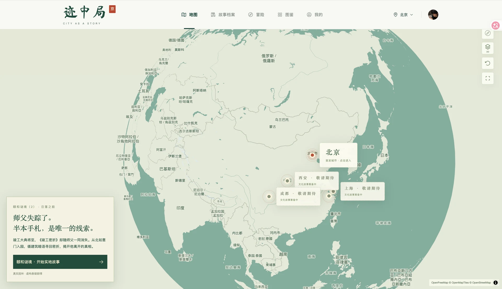

首页使用真实矢量地图，而非一张静态示意图。地图支持从全国视野连续缩放至北京市、颐和园及园内点位，并提供拖动、旋转、视角切换、复位等操作。地图的故事入口介绍“师父失踪、半本手札”的悬疑背景，让游客知道进入后要做什么。其他城市以“敬请期待”标示，尚未宣称开放对应剧情。

地图使用浅色底图、墨绿水系和朱红探索标记。公开 DEM、山体阴影、动态水面与建筑体量用于改善空间感；部分高度及屋顶造型是解释性表现，不是摄影级实景扫描。参考点和线索关联不等于经实地校准的导航路线。

### 2. 故事档案：同一园林，两种表达

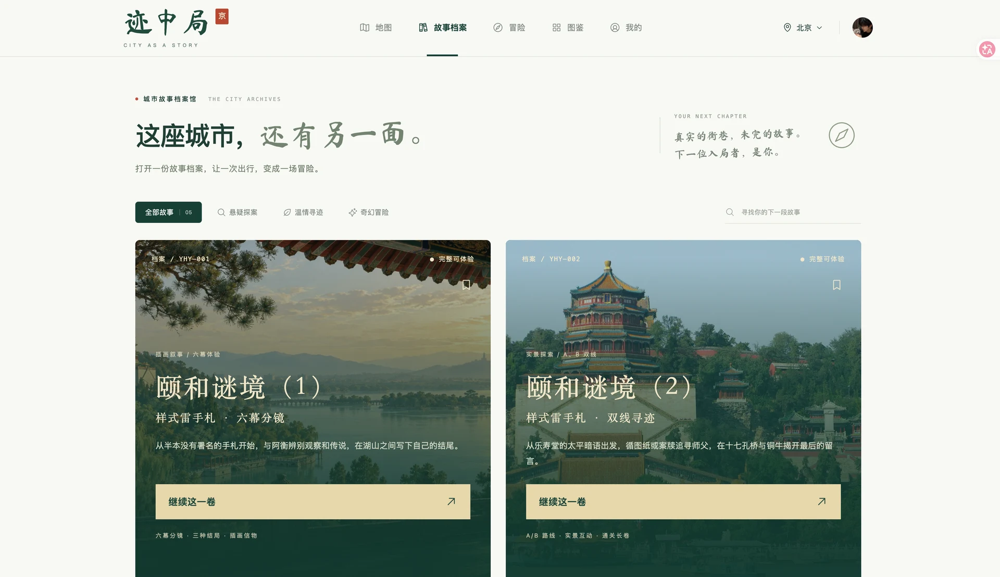

《颐和谜境（1）》强调插画叙事与六幕分镜；《颐和谜境（2）》强调实景探索与 A/B 双线。两套故事同时存在，分别保留进度和收藏内容，方便观众比较视觉、节奏与交互方式。

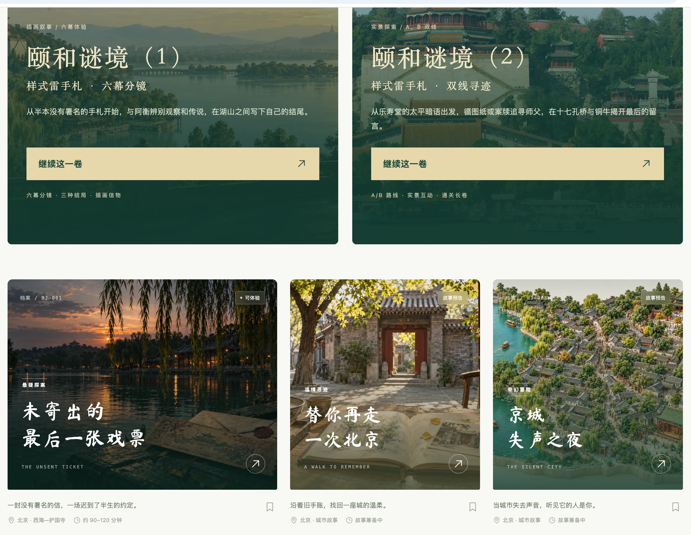

档案馆提供故事分类、搜索与收藏，也保留《未寄出的最后一张戏票》早期可玩体验，以及温情、奇幻方向的预告。预告与可体验内容有明确标识，后续可逐步扩展城市与题材。

### 3. 第一卷：以分镜与对白建立代入感

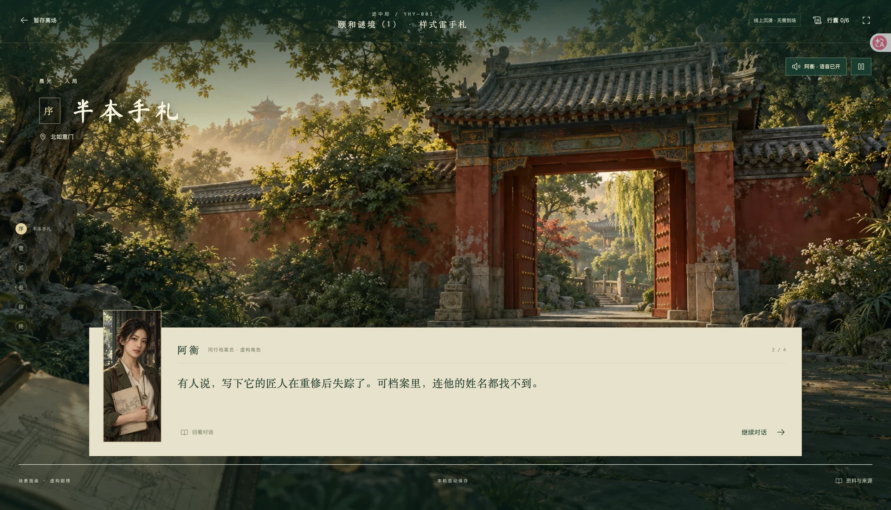

全屏场景、矿物青绿氛围、象牙色纸本对话框与阿衡人物形象共同构成沉浸视觉。玩家逐句推进对白，查看当前章节和行囊，随时暂停离场；角色语音支持开关、重播与暂停。

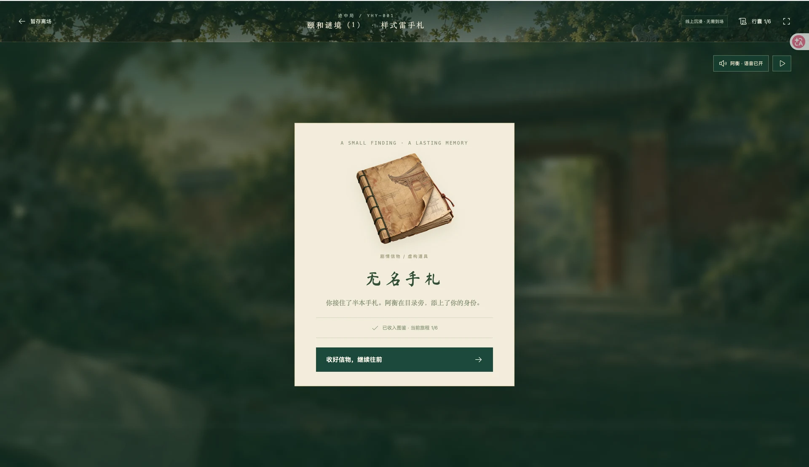

完成对应探索后，剧情信物以独立奖励卡展示，包含物品图、名称、说明和当前收集进度。奖励不是与故事无关的分数，而是承接下一幕的记忆物件。

### 4. 第二卷：先讲清危机，再翻开手札

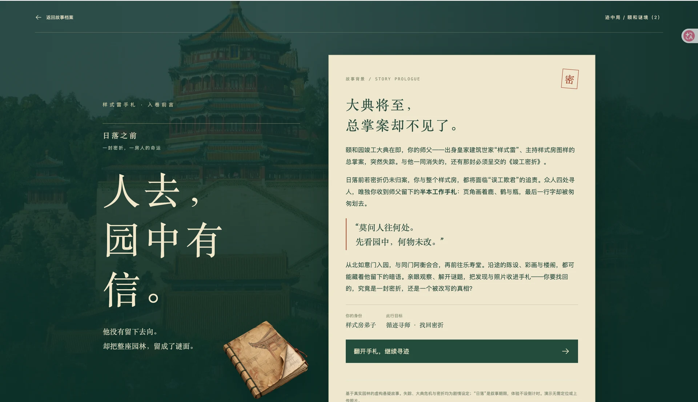

第二卷先展示“日落之前”背景：师父与《竣工密折》同时消失，玩家收到半本手札，从北如意门入园，与阿衡会合。纸本序章交代身份、任务和悬念，再由玩家主动进入 NPC 对话。日落是叙事期限，游戏不设置真实倒计时。

### 5. 乐寿堂：寻找、辨认与解意

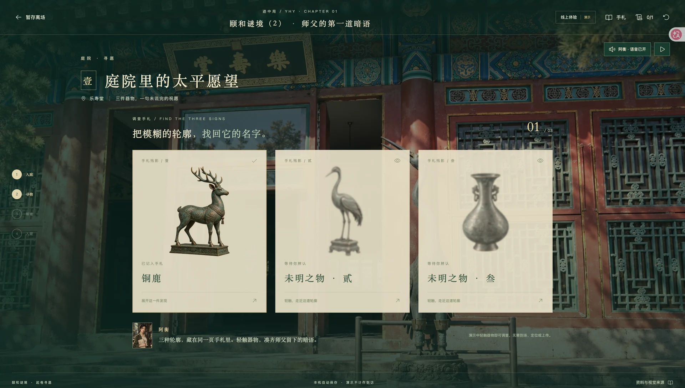

玩家从模糊轮廓中辨认铜鹿、铜鹤与铜花瓶，逐件查看并记入手札。调查完成后，结合谐音和陈设寓意理解“六合太平”。关卡依次组织“入庭—寻物—解意—入藏”，让文化含义成为解谜结果。

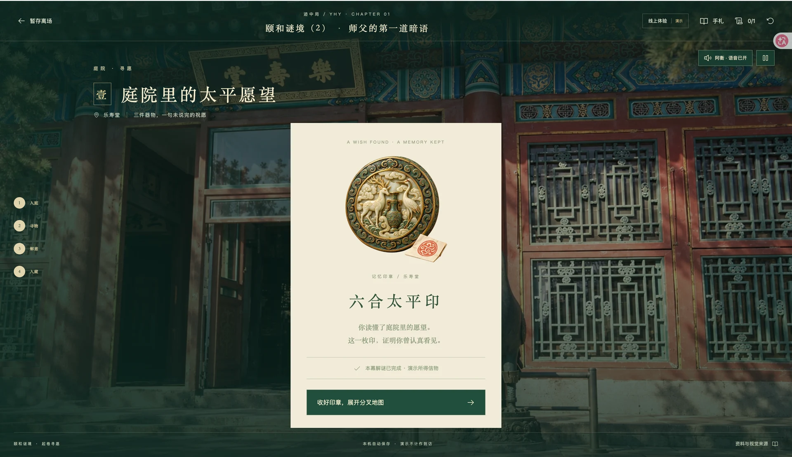

读懂庭院中的愿望后，玩家获得“六合太平印”，并展开后续 A/B 分叉地图。印章既是本幕完成反馈，也是图鉴里的可回看记忆。

### 6. 长廊：让画面成为剧情证据

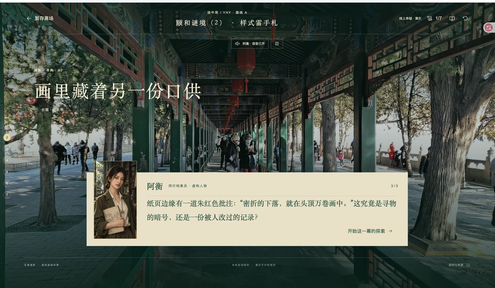

第二卷采用与地点相应的实景摄影，阿衡通过任务对白引导玩家观察画面、比较记录。关卡中的彩画、建筑差异、取景视线都服务于寻师和密折主线，而不是独立堆放知识问答。

### 7. 冒险：暂停后仍能接着走

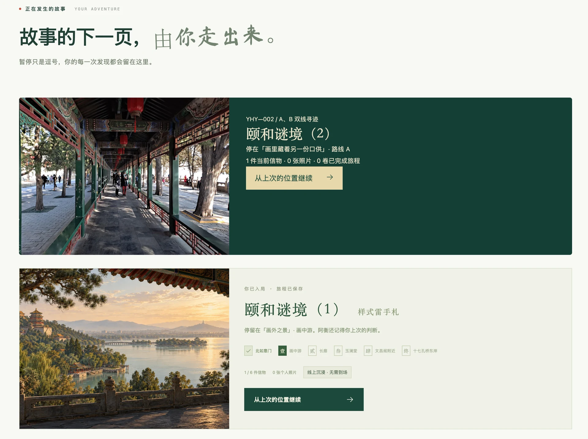

“冒险”页集中显示当前章节、当前路线、信物与照片数量，提供续玩入口。第一卷与第二卷分别记录，玩家可以在不同故事之间切换，不必为了比较另一种风格覆盖已有进度。

### 8. 图鉴：收下的每一件，都与旅行有关

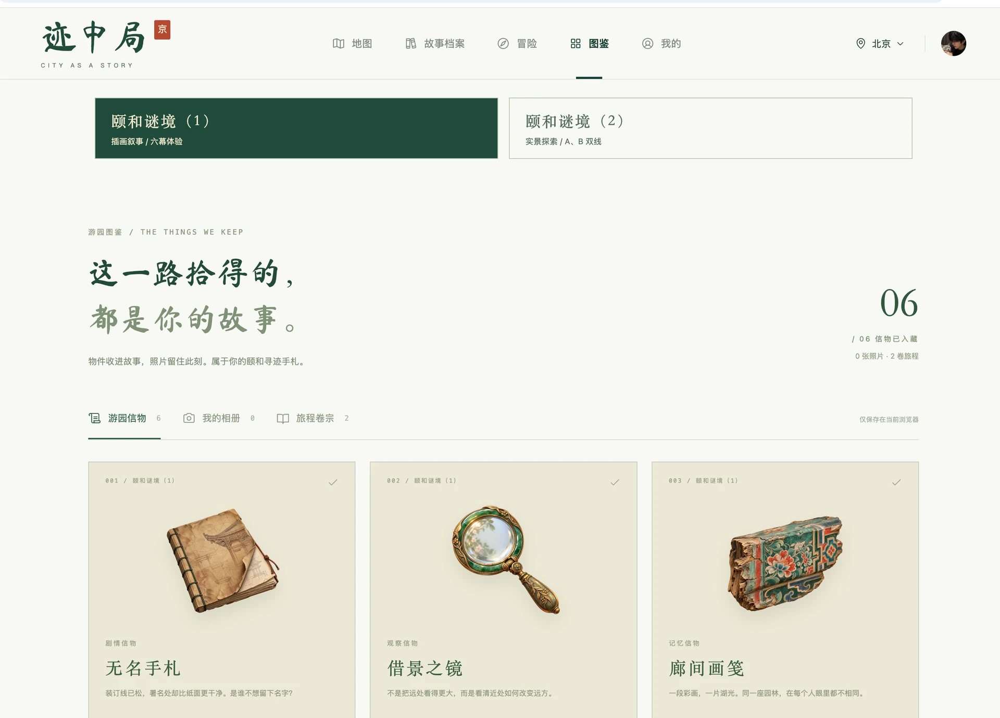

图鉴可在两套颐和故事之间切换，分别查看游园信物、个人相册与完成卷宗。相同主题下的两种体验使用独立身份，避免照片、奖励和记录混在一起。


第一卷包括无名手札、借景之镜、廊间画笺、留白之印、重檐校样与桥影留笺。每张卡片提供物品图、类别、线索文案和详情入口。第二卷则按关卡收集相应印章与信物，完成后生成可保存的通关长卷。

### 9. 我的：旅人身份与个人档案

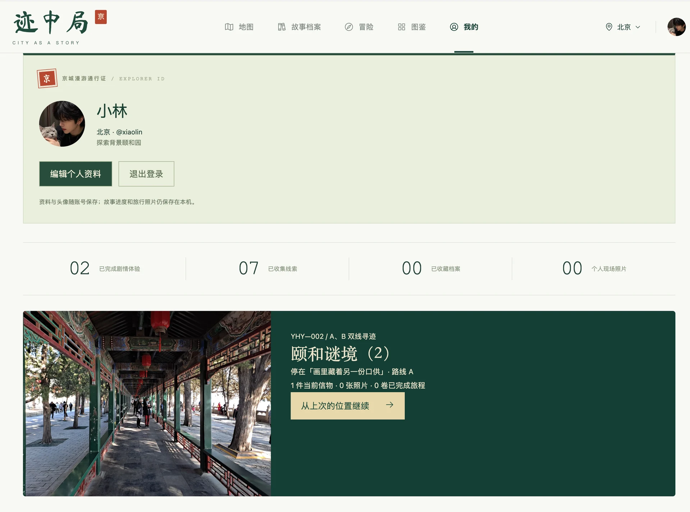

账号支持注册、登录、退出和个人资料编辑，可保存昵称、城市、简介及压缩头像。用户资料通过 Cloudflare D1 保存；故事进度、照片和体验卷宗仍保存在当前浏览器，两者不混为跨设备云存档。

## 两套故事与关卡设计

### 《颐和谜境（1）》：样式雷手札 · 六幕分镜

第一卷以半本无署名手札为起点，与阿衡一起辨别观察、传说和资料中的矛盾。在六幕场景中逐步收集六件信物，保留既有分支与三个归档结尾。其重点是完整的视觉叙事、对话节奏、插画信物和个人观察。

### 《颐和谜境（2）》：样式雷手札 · 双线寻迹

> 竣工大典将至，师父却带着《竣工密折》消失了。唯独你收到半本工作手札：页角画着鹿、鹤与瓶，最后一行字被匆匆划去。你从北如意门入园，在阿衡陪伴下循建筑暗语寻师。你要找回的，究竟是一封密折，还是一个被改写的真相？

第二卷依据团队详细关卡表改编。乐寿堂为共通开局，之后分别沿“匠人之骨”和“案牍之疑”推进，最终在十七孔桥与铜牛处合流。下表包含玩法提示，想自行探索的玩家可以先直接进入游戏。

| 路线 | 地点／章节 | 主要交互 | 关卡设计目的 |
| --- | --- | --- | --- |
| 共通 | 乐寿堂 | 辨认三件器物、调查记录、谐音解谜 | 让真实陈设与文化祝愿构成第一道暗语 |
| A | 长廊 | 揭开彩画、辨认人物与旗色 | 把手札提示与实际图像对照，练习寻找细节 |
| A | 佛香阁 | 调整掌中托阁构图、记录尝试、判断建筑形制 | 引导主动选择视角，理解建筑层次与尺度 |
| A | 画中游／湖山视角 | 调整取景框、对齐景观 | 感受园林中的借景关系，并留下个人观看方式 |
| A | 清晏舫 | 滑动比较假想图稿与实景、寻找差异 | 通过对照发现记录的变化，继续追寻密折 |
| B | 仁寿殿 | 判断铜凤、铜龙的数量与摆放关系 | 把陈设秩序转化为需要观察的线索 |
| B | 文昌阁 | 对照假想图稿与实景、判断层数 | 发现档案与现场不一致，推动案牍疑点 |
| 合流 | 十七孔桥 | 选择中心桥洞、双向数洞、解开数字暗语 | 从对称结构和视角切换中获得解谜反馈 |
| 合流 | 铜牛 | 调整牛角借景、排列任务短句 | 完成视线线索，读到师父的最后留言 |
| 卷终 | 旅程长卷 | 查看信物、照片与笔记，导出纪念图 | 把观察和选择收束为属于自己的旅行记忆 |

**故事的收束：**两条路线分别呈现师父作为匠人与总掌案面对记录矛盾时的选择，最后回到“看清园林、诚实留下所见”的主题。图稿篡改动机、师父去向以及数字锁的剧情寓意属于虚构，不据此推断历史人物的真实行为。

## AI 的使用方式

项目的 AI 应用同时覆盖内容制作与运行服务，但当前演示不会把未接入的能力描述为已完成。

| 环节 | 当前实现 | 说明 |
| --- | --- | --- |
| NPC 配音 | 火山引擎／豆包 TTS 2.0，Vivi 2.0 音色 | 阿衡对白预生成 MP3，按播放清单匹配文本，减少游玩时等待；属于合成配音，并非真人录制 |
| 场景与信物美术 | 插画资产、实景摄影及氛围处理并用 | 第一卷保留插画风格，第二卷更多使用地点实拍；剧情道具和假想图稿与实景区分 |
| NPC 对话与提示 | 预设文本、分支与关卡状态驱动 | 当前主体验不是自由生成式 Agent 对话；避免因临场生成而破坏故事逻辑 |
| 严格线下核验原型 | 保留 Cloudflare Workers AI 校验接口 | 包含图像描述、任务判断与朗读识别代码；不等于当前演示已强制启用或已完成景区实测 |
| 后续方向 | 有资料约束的角色问答、观察反馈与分层提示 | 计划逐步增加动态回应，并保持历史资料与虚构叙事边界 |

配音播放清单位于 `src/palace/voice-clips.json`，生成脚本为 `scripts/aheng-tts.mjs`。已提交的音频可直接播放；只有重新生成配音时才需要服务端／本机 TTS 密钥，浏览器不持有该密钥。

## 技术栈与系统架构

### 技术选型

| 层级 | 技术 | 用途 |
| --- | --- | --- |
| 前端界面 | React 19.2、JavaScript / JSX、原生 CSS | 五个主导航、沉浸场景、分支对话、收藏与响应式布局 |
| 构建工具 | Vite 6.4、React 插件 | 开发服务、模块构建、按需加载与静态产物生成 |
| 图标与品牌 | Phosphor Icons、本地书法字体、SVG favicon | 统一地图控件、功能图标与品牌视觉 |
| 地图引擎 | MapLibre GL JS 5.6.2 / WebGL | 单实例连续缩放、倾斜视角、真实矢量地图与图层交互 |
| 地理数据 | OpenFreeMap、OpenMapTiles、OpenStreetMap、公开坐标与 DEM | 道路、水系、地形、建筑轮廓及主要景点展示 |
| 浏览器能力 | Geolocation、File API、Canvas、音频播放 | 定位、照片选择与压缩、纪念图生成、NPC 配音 |
| 本机保存 | localStorage、IndexedDB | 剧情状态、偏好、信物、照片与旅程记录 |
| 后端与托管 | Cloudflare Workers、静态 Assets、自定义域名 | 静态资源分发、同源 API 与 HTTPS 线上体验 |
| 账号数据库 | Cloudflare D1 / SQLite | 用户、会话、个人资料与请求限额记录 |
| AI 服务 | 豆包 TTS 2.0、Cloudflare Workers AI | 预生成角色配音及保留的严格核验原型 |
| 工程工具 | Node.js、npm、Wrangler、Node 内置测试 | 依赖管理、构建、发布与业务逻辑回归 |

### 运行结构

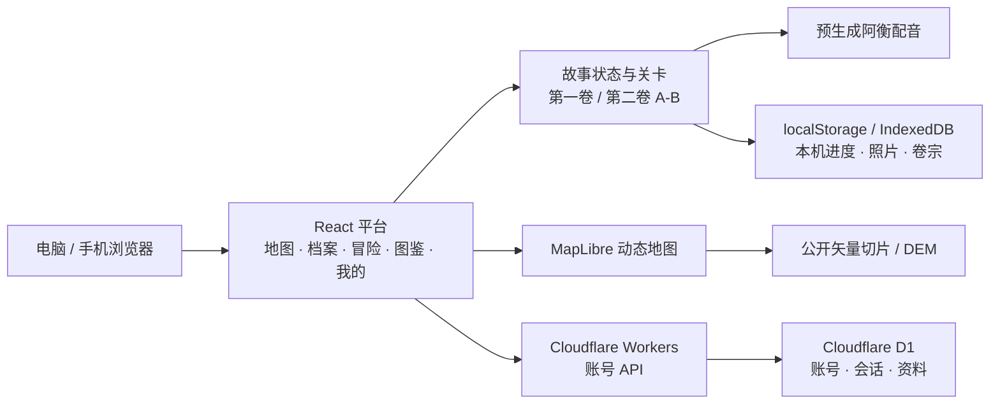

地图、剧情、照片和账号采用不同的职责边界。登录账号不自动上传当前故事照片；第二卷的 A/B 路线由状态机推进，不依赖模型临场决定下一关。地图寻找位置与当前关卡分开呈现，返回后可继续已挂载的任务。

### 主要目录

```text
jizhongju-web/
├── src/
│   ├── App.jsx                 # 顶层入口与故事路由
│   ├── LegacyApp.jsx           # 通用平台与第一卷入口
│   ├── stories.mjs             # 两套故事的稳定身份与元数据
│   ├── brand/                  # 品牌字标与共享样式
│   ├── map/                    # 地图、镜头、景点、材质与地形
│   ├── palace/                 # 第一卷六幕故事、存储、语音组件
│   ├── leshoutang/             # 第二卷共通开局：乐寿堂
│   ├── expedition/             # 第二卷序章、A/B路线、谜题与结局
│   ├── library/                # 双版本档案、收藏与旅程界面
│   ├── account/                # 账号与资料界面
│   └── trail/                  # 严格线下核验的早期原型模块
├── cloudflare/
│   ├── worker.mjs              # 账号 API 与静态资源入口
│   ├── game.mjs                # 保留的线下核验 API
│   └── schema.sql              # D1 数据库结构
├── public/
│   ├── assets/                 # 场景、信物、字体与预生成配音
│   ├── showcase/               # Web/移动端演示视频与播放器页
│   └── favicon.svg             # 品牌浏览器图标
├── docs/
│   ├── media/                  # README截图、海报、二维码与来源清单
│   └── source-extracts/        # 团队关卡稿与声线设定摘录
├── scripts/                    # 配音生成与构建适配脚本
├── tests/                      # 地图、故事、账号、语音等逻辑测试
├── wrangler.jsonc              # Cloudflare部署与资源绑定
└── README.md
```

## 本地运行与部署

### 1. 安装与启动前端

建议使用仍受支持的 Node.js LTS（22 或更新版本）及 npm。在克隆仓库后进入项目目录：

```bash
git clone https://github.com/linyuchao123/jizhongju-web.git
cd jizhongju-web
npm ci
npm run dev -- --host 127.0.0.1 --port 4173 --strictPort
```

打开 `http://127.0.0.1:4173/`。地图需要联网请求公共切片；前端演示及现成配音不需要自行申请地图密钥或 TTS 密钥。

> Vite 开发服务仅启动前端，不会自动模拟 Cloudflare D1 账号 API。若只想体验完整已部署功能，请使用上方在线网址；如需本地账号 API，继续参考下一节。

### 2. 构建与静态预览

```bash
npm run build
npm run preview -- --host 127.0.0.1 --port 4174
```

静态产物在 `dist/client/`。构建脚本同时保留 `dist/server/index.js` 和 `dist/.openai/hosting.json` 的模板适配产物；当前正式站点使用 Cloudflare Workers 的 `cloudflare/worker.mjs` 发布。

### 3. 运行逻辑测试

```bash
node --test tests/*.test.mjs
npm run test:sites
```

测试覆盖故事推进、A/B 路线条件、两版数据隔离、配音文本覆盖、地图距离与视角计算、账号接口以及构建适配。自动测试不替代手机实机音频、景区开放情况、现场 GPS 与真实照片识别的验收。

### 4. 本地 Worker 与账号数据库

```bash
npm run build
npx wrangler d1 execute jizhongju-accounts --local --file=cloudflare/schema.sql
npx wrangler dev
```

以上命令使用 `wrangler.jsonc` 中的绑定名启动本地环境。Cloudflare AI 相关功能另需有效账户与服务配置；当前演示主流程不依赖其通过校验。

### 5. 部署到自己的 Cloudflare 账户

1. 登录自己的 Cloudflare 账户，创建 D1 数据库。
2. 将 `wrangler.jsonc` 中的 `account_id`、D1 `database_id`、域名路由改为自己的资源，不要直接沿用本仓库的生产资源配置。
3. 为自己的数据库执行结构初始化，确认 `DB`、`ASSETS` 以及需要时的 `AI` 绑定。
4. 构建并部署，最后在自己的域名检查地图、故事、账号与媒体资源。

```bash
npx wrangler login
npx wrangler d1 create your-database-name
# 修改 wrangler.jsonc 中对应配置后：
npx wrangler d1 execute your-database-name --remote --file=cloudflare/schema.sql
npm run build
npx wrangler deploy
```

部署到自定义域名需要拥有对应 DNS 管理权限。地理定位与相机等浏览器能力通常需要 HTTPS 或受信任的本地环境；手机通过普通局域网 HTTP 访问时可能受到限制。

### 6. 可选：重新生成阿衡配音

已有 MP3 随仓库提供，普通运行无需生成。开发者改动对白后，可在本机设置 `VOLC_TTS_API_KEY`，根据需要设置 `VOLC_TTS_SPEAKER`，再运行：

```bash
node scripts/aheng-tts.mjs --sample
node scripts/aheng-tts.mjs --all
```

默认音色为 `zh_female_vv_uranus_bigtts`。调用外部 TTS 可能产生账户费用；请使用自己的服务账户。密钥只放在环境变量或已忽略的本机环境文件中，不写进源码、README、前端或 Git 历史。

## 数据保存与隐私边界

| 数据 | 保存位置 | 当前行为 |
| --- | --- | --- |
| 账号及会话 | Cloudflare D1 | 服务端校验账户，会话通过 Secure / HttpOnly Cookie 传递 |
| 昵称、城市、简介、头像 | Cloudflare D1 | 随账号资料保存；头像经过压缩 |
| 剧情进度、信物、路线、偏好 | 当前浏览器 localStorage | 刷新可继续；更换浏览器或清除数据可能丢失 |
| 个人照片 | 当前浏览器 IndexedDB；部分起卷记录使用本机存储 | 不因登录自动上传，不提供跨设备云相册 |
| 地图定位 | 浏览器权限与本机地图计算 | 当前地图定位不作为到访凭证，不由地图功能保存到本项目服务器 |
| 严格核验原型的照片／朗读 | 仅在对应核验提交时发送处理 | 与当前无需上传的演示主流程区分；未完成正式景区验收 |

两套颐和故事使用独立故事标识与存档键，收藏和照片按所属故事区分。重开故事不应覆盖另一卷内容；清除浏览器数据仍会影响本机记录，重要照片和纪念图请自行导出保存。

地图切片服务会收到正常的资源请求。账号已有密码散列、会话与请求限额等措施，但本项目仍是黑客松作品，不宣称完成商业级安全审计、反作弊体系或身份实名认证。

## 当前完成度与后续计划

### 当前可体验

- 五个主导航及适配手机的底部导航。
- 真实矢量地图、连续镜头、公开地形与园内主要景点展示。
- 两套独立颐和故事：六幕插画叙事与 A/B 实景寻迹。
- 第二卷背景序章、固定 NPC 阿衡、预生成角色配音。
- 多种点击、选择、构图、滑动对照和数字解谜交互。
- 信物奖励、图鉴、可选个人照片、笔记与本机续玩。
- 第二卷通关长卷生成与保存。
- 已部署的注册、登录及个人资料功能。
- Web 与移动端完整录屏、项目海报与扫码体验入口。

### 后续迭代方向

- **真实游玩校准：**实测路线可达性、观察点、开放范围、GPS 容差与任务时长。
- **资料约束的 AI NPC：**让角色根据玩家观察提供自然反馈，同时保持历史知识来源和剧情一致性。
- **照片与观察反馈：**在获得明确同意后加入更可靠的视觉核验与拍摄建议，并解释失败原因。
- **内容生产工具：**把故事节点、地点、文化依据、素材、对白与奖励组织为可编辑的剧本工作台。
- **跨设备保存：**设计账号与照片、进度的同步和删除机制，避免把现有登录能力误称为云存档。
- **微信小程序：**在验证 Web 核心体验后开发正式小程序，适配更多移动端权限与使用场景。
- **更多城市与主题：**逐步扩展文化景区、街区与不同叙事风格；未开放内容继续清楚标示为预告。

## 素材来源与团队

### 图片、声音与地理数据

- 本 README 的截图、海报、二维码和两段录屏由团队提供；文档素材映射见 [docs/media/sources.json](docs/media/sources.json)。截图中的个人档案为团队展示内容。
- 第二卷实景摄影的作者、原始链接与许可记录在 [src/expedition/photos.json](src/expedition/photos.json)；其他摄影来源见相应模块的 `photos.json`。
- 第一卷场景、人物与信物含 AI 辅助美术；第二卷的假想图稿是剧情演绎，不是历史原图或测绘复原。
- 阿衡配音由豆包 TTS 2.0 合成，音频清单记录来源与音色，不冒称真人演员录音。
- 底图来自 [OpenFreeMap](https://openfreemap.org/)、[OpenMapTiles](https://openmaptiles.org/) 与 [OpenStreetMap contributors](https://www.openstreetmap.org/copyright)，请保留原有署名和许可说明。
- 技术来源与实现细节可查阅 [地图说明](docs/map-implementation.md)、[配音说明](docs/aheng-emotional-voice.md)、[两套故事说明](docs/two-editions-2026-11-01.md)。部分过程文档记录的是旧版本，当前行为以源码和本 README 的完成度说明为准。
- 仓库公开可见不代表所有摄影、字体、音频、海报与代码自动适用同一开源许可；复用前请分别核对授权。

### 团队与赛事

**团队名称：文化工作者要有文化。**

**作品身份：2026年北京AI青年国际黑客松现场开发作品，文化赛道。**

团队围绕文化内容、故事策划、交互视觉、前端实现与演示体验协作，以北京颐和园为第一站，探索 AI、游戏与真实旅游场景如何形成连贯的产品体验。我们希望游客带走的不只是“到过这里”，而是“我在这里发现了什么”。

### 仓库资料展示

<details>
<summary>仓库介绍设置参考图（团队提供）</summary>

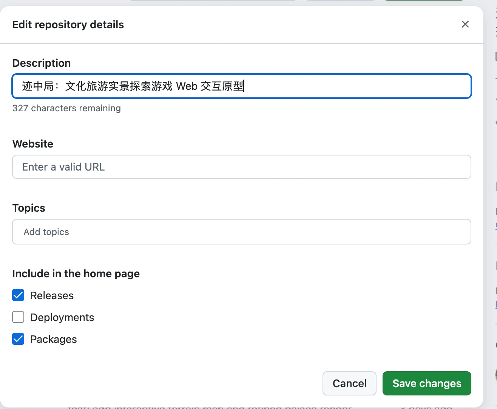

这是团队提供的仓库资料编辑参考图，属于项目整理过程记录，不是游戏界面。仓库 About 使用简明介绍、在线体验网址与技术主题标签；产品与实现细节以本 README 为主。

</details>

---

**[打开迹中局，开始你的下一段故事 →](https://jizhongju.xiaolinyx.me)**
